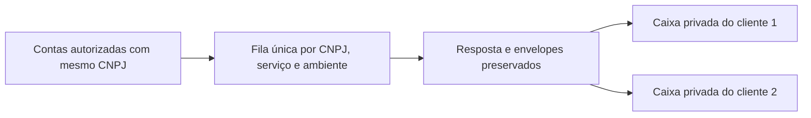

# Gestão de cadastros, rejeição 656 e preparação PostgreSQL

Entrega de **22/10/2026**. Complementa a [revisão final da plataforma](REVISAO-FINAL-E-PUBLICACAO.md). Horários narrados em Brasília; o JSON do diagnóstico inclui o deslocamento UTC explicitamente.

## Resultado

Implementados controles administrativos por cliente, empresa, certificado e serviço, com confirmação, permissões e auditoria. Nenhuma conta real foi excluída ou desativada automaticamente. Os dois vínculos reais, seus A1, XMLs e cursores foram preservados.

A duplicidade identificada usa uma fila comum, não duas sequências independentes. Não foi encontrada quebra na cadeia local aceita que comprove a causa do 656. Foram corrigidos o limite de consultas por identidade em cada ciclo e um fallback de persistência da resposta. **Isso não permite declarar o 656 resolvido**: nenhuma consulta fiscal de validação foi disparada nesta investigação.

PostgreSQL permanece preparação, sem migração dos dados reais ou servidor criado. Foram acrescentados testes para backend PostgreSQL real, separados dos testes que SQLite consegue executar.

## 1. Onde gerenciar

Entre na conta master existente e acesse:

1. **Gestão master** → **Operação e cadastros** do cliente.
2. **Gerenciar conta, empresas e certificados**.
3. Escolha o cliente/empresa e revise o efeito antes de confirmar.

Endereços locais diretos:

- Cliente CODEX: `http://127.0.0.1:8000/gestao/clientes/1/gerenciar/`.
- Cliente VINDEX - TESTE 2: `http://127.0.0.1:8000/gestao/clientes/3/gerenciar/`.
- Empresa Alpha Pet: `/gestao/clientes/1/empresas/5/gerenciar/`.
- Empresa VINDEX - TESTE 2: `/gestao/clientes/3/empresas/6/gerenciar/`.

Esses caminhos exigem **admin_master e operate_clients**. A conta master atual possui ambas. Um master somente de supervisão não pode usar as ações; usuários comuns também não. A supervisão do painel cliente continua em leitura e não recebeu permissões de escrita.

| Controle | Efeito |
|---|---|
| Desativar conta | Marca o Workspace suspenso; bloqueia acesso privado/API e participação fiscal dos seus vínculos. Preserva configurações e histórico. |
| Reativar conta | Retorna ao estado ativo; serviços antes habilitados podem retomar conforme os requisitos e esperas existentes. |
| Desativar empresa | Registra `deactivated_at`; nenhum conector consulta por esse vínculo. Documentos permanecem acessíveis no histórico autorizado. |
| Reativar empresa | Remove essa marca, preservando preferências/consentimentos; serviços habilitados podem retomar conforme a agenda. |
| Pausar NF-e/NFS-e/CT-e | Altera somente o serviço e ambiente selecionados da empresa. |
| Retomar serviço | Reutiliza consentimento existente, valida A1/requisitos e habilita o serviço. Não cria autorização inicial, não envia manifestação e não reduz espera. |
| Vincular/substituir A1 | Reaproveita validação de CNPJ/vigência, Fernet e armazenamento existentes; não cria novo histórico por certificado. |
| Remover A1 | Apaga somente a cópia cifrada desse vínculo e pausa seus três serviços. Outros A1 e filas permanecem; para voltar será necessário vincular um A1 pela aplicação. |
| Revisar exclusão definitiva | Mostra impedimentos/contagens. Só permite cadastro vazio; não faz limpeza de dados fiscais por cascata. |

Uma chamada já em andamento pode concluir; os bloqueios impedem novas consultas pelo vínculo desativado, com revalidação no uso do A1. Os demais clientes autorizados do mesmo CNPJ continuam participantes.

As permissões de contas administrativas não são removidas por esse fluxo de clientes: desativação de contas administrativas e exclusão da própria conta master são bloqueadas. O proprietário regular suspenso pode ter a autenticação reconhecida, mas suas áreas privadas e API ficam bloqueadas; suspensão de Workspace não equivale a apagar o login.

## 2. Segurança da exclusão

Desativação lógica é a opção recomendada para os cadastros de teste que já têm documentos. Ela é reversível. **A exclusão física não é um atalho para apagar notas e liberar espaço.**

Para exclusão física são exigidos POST, CSRF, as duas permissões, leitura dos efeitos, confirmação marcada e texto exato `EXCLUIR CLIENTE <id>` ou `EXCLUIR EMPRESA <id>`. O servidor reconta referências sob transação/bloqueio; não depende de botão desabilitado no navegador.

Documentos, estados/consentimentos fiscais, certificados, credenciais e auditorias vinculadas bloqueiam a exclusão. Auditorias do Django e referências de autorização do login também são protegidas. Nesse caso a orientação é desativar, preservando tudo. Ao excluir uma conta realmente vazia, somente Workspace/login são removidos e uma auditoria independente mantém os IDs removidos e o administrador responsável.

Não existe operação de apagar stream compartilhado nesses controles. Mesmo a exclusão permitida de cadastro vazio não remove fila por CNPJ. Não há chamada externa de revogação do certificado, cancelamento de nota ou evento fiscal.

## 3. Cadastros repetidos identificados

| Cliente | Empresa | CNPJ | Estado nesta entrega |
|---|---|---|---|
| CODEX — Workspace 1 | Alpha Pet LTDA — empresa 5 | 55.737.823/0001-96 | Ativo; preservado |
| VINDEX - TESTE 2 — Workspace 3 | VINDEX - TESTE 2 — empresa 6 | 55.737.823/0001-96 | Ativo; preservado |

As duas cópias de certificado têm o mesmo fingerprint, sem divulgação desse identificador ou do conteúdo. Não foi escolhido automaticamente qual cadastro o usuário deseja manter.

Para deixar apenas o vínculo principal participando, abra o cadastro de teste e **desative a conta** ou pause os serviços da empresa. A escolha e a confirmação são suas na aplicação. Isso reduz participantes/cópias futuras, mas **não comprova nem garante resolver o 656**.

A tela de gerenciamento identifica CNPJs também presentes em outros clientes e permite abrir os vínculos correspondentes, com controle administrativo. A identidade do documento/histórico continua separada da identidade do certificado.

## 4. Auditoria da distribuição e hipótese de duplicidade

Foi criada a rotina local:

```powershell
.\.venv\Scripts\python.exe manage.py auditar_distribuicao --cnpj 55737823000196 --ambiente 1
```

Ela não abre certificado, não faz HTTP e não altera o banco. Mostra metadados de tentativas, cadeia aceita, esperas, janelas sobrepostas e participantes. Não mostra XMLs, chaves de notas, A1 ou senhas.

Resultado da amostra auditada, com última resposta oficial registrada em **22/10 às 09:33:01**:

- **780 registros de tentativa**, todos originados pelo vínculo da empresa 5. A empresa 6 recebe sua caixa privada pela entrega interna; não há segunda série de consultas NF-e registrada para ela.
- **769 registros com corpo de resposta preservado**.
- Códigos gravados: **771 × 138**, **7 × 656**, **1 × 404**, **1 sem código**. O 404 aqui é o campo de status registrado, não uma afirmação sobre HTTP.
- **Zero diferenças** entre NSU solicitado e continuidade do último NSU aceito localmente, na comparação dos registros disponíveis.
- **Zero tentativas detectadas antes da espera mínima de uma hora**, quando a resposta anterior registrada exigia essa espera.
- **Zero sobreposições nas janelas locais de tentativa/conclusão**.
- Uma única `SefazDistributionStream` de produção para esse CNPJ; uma `FiscalStream` NFS-e e outra CT-e, com unicidade por serviço/ambiente.

**Limites:** uma tentativa é registrada antes do fetch e não prova envio/recebimento remoto quando falta resposta. Dos 11 registros sem corpo, nove têm 138 legado, um tem 404 e um falhou sem código. Não foi possível reconstruir esses corpos nem afirmar a contagem exata de chamadas recebidas pela SEFAZ apenas a partir deles. Janela local pode incluir processamento; ausência/presença de sobreposição não mede diretamente HTTP simultâneo. Os dados não mostram consumidores externos ou respostas perdidas antes da gravação.

O código do transporte recebe o cursor da fila depois da reserva condicional e de recarregar o estado. Os documentos distribuídos são persistidos com o avanço do cursor em transação. A entrega posterior a cada Workspace é separada: XML ainda não interpretado no cliente não significa que a página precise ser baixada novamente.



**Ajuste aplicado:** antes, dois cadastros podiam consumir duas páginas **diferentes e sequenciais** durante a mesma volta do worker. Não eram necessariamente repetições do mesmo NSU, mas a frequência poderia depender do número de cadastros. Agora a volta coordena uma consulta por identidade, mantendo entrega local aos demais. Uma falha de A1/configuração antes de iniciar consulta não impede que outro vínculo válido seja o consumidor. As reservas no banco continuam sendo a proteção entre processos; o conjunto por volta não substitui leases/uniqueness.

Os testes comprovam entrega a dois clientes com uma chamada sintética, ausência de bloqueio do vínculo válido por A1 inválido e independência entre serviços. **Não foi comprovado que a duplicidade causava a rejeição observada.**

## 5. Rejeição 656 e correção de persistência

Estado preservado do piloto:

- NSU local aceito/armazenado: **123317**.
- Máximo da última aceitação: **133839**.
- NSU informado na última rejeição auditada: **134134**.
- Última aceitação registrada: **21/10 às 19:28**, horário oficial.
- Última rejeição auditada: **22/10 às 09:33:01**, produção.
- Próxima consulta permitida naquela agenda: **22/10 às 11:33:01**. A agenda normal pode avançar após esse retrato.

O 656 aponta uso indevido/continuidade pelo `ultNSU`. Não deve ser considerado consequência normal de um download grande. A espera e a sequência devem ser coordenadas pelo CNPJ, mesmo com várias aplicações autorizadas. Não foi aplicado salto para o NSU da rejeição nem alterada a margem de duas horas.

Fontes primárias: [informe oficial NF-e](https://www.nfe.fazenda.gov.br/portal/informe.aspx?AspxAutoDetectCookieSupport=1&Informe=0cu%2FyBLKrCs%3D&ehCTG=false) e [NT 2014.002 publicada no Portal](https://www.nfe.fazenda.gov.br/Portal/exibirArquivo.aspx?conteudo=U0LlsYVGBRU%3D). Não se usa indiscriminadamente o limite de consultas pontuais por chave/NSU como limite de todas as páginas de distribuição.

**Falha concreta corrigida em teste:** se a primeira gravação de `response_xml` falhasse temporariamente após receber o retorno, o handler de erro salvava metadados sem incluir novamente o corpo que ainda estava em memória. Agora esse fallback tenta preservar também o corpo pelo armazenamento existente. Isso permite recuperação local posterior, validada pelo schema, sem repetir HTTP. O teste simula a falha, comprova que o cursor não avança só por metadados e que a recuperação usa o retorno preservado mantendo a espera.

Essa correção não recupera respostas antigas ausentes, não resolve indisponibilidade persistente do banco e **não prova a causa do 656 do piloto**. Os corpos ausentes encontrados são registros iniciais/legados; não foram arbitrariamente associados a essa falha.

Continuam sem comprovação: consumidor externo, resposta perdida antes da durabilidade ou divergência de estado remoto por condição não representada nos registros locais. Não há fundamento para zerar/trocar o cursor. Uma validação fiscal real da solução fica **pendente de autorização específica**, sem execução manual nesta etapa. A captura regular existente não foi desligada para produzir um diagnóstico artificial.

## 6. Desativação e uso do A1 no worker

Foram acrescentados filtros de elegibilidade e revalidação local no uso do A1: empresa não desativada, cliente ativo, dono ativo e ausência de pausa geral. Isso vale para NF-e, NFS-e, CT-e, entrega entre vínculos e operações que usam o contexto do certificado. Não se confia só na preferência `enabled` de um serviço quando a conta/empresa está bloqueada.

A suspensão já existente do cliente agora também bloqueia participação fiscal, mantendo as preferências `enabled` para reversão. API e acesso privado permanecem bloqueados pela conta. A reativação não reabre intervalos nem autoriza serviços/ambientes nunca consentidos.

Foi aplicada a migração **0014**, somente uma coluna nula `Company.deactivated_at`. O SQL SQLite foi conferido: `ALTER TABLE ... ADD COLUMN ... NULL`, sem reconstrução da tabela de documentos. Os cadastros existentes continuam ativos por padrão. O banco real segue SQLite; não houve migração para PostgreSQL.

O worker foi recarregado para utilizar os bloqueios, em janela sem leases fiscais ativos, mantendo suas reservas/agendas persistidas. Não foi executado `--once` ou outro comando de captura manual para investigar. O sinal do processo e a tarefa foram conferidos após o carregamento.

## 7. Preparação PostgreSQL

Reaproveitada a receita em `deploy/`, configuração PostgreSQL em `config/settings.py`, dependências em `requirements-production.txt` e migração cifrada VFX2. Nenhuma chave real foi rotacionada. O comando de restauração continua aceitando somente banco vazio e validando a integridade antes da carga.

Conferência técnica: modelos usam FK/constraints e JSONField nativos do Django; `deactivated_at` é DateTimeField nulo; leases usam atualização condicional e gravação transacional com bloqueio de linha onde necessário. O cursor só avança com armazenamento do retorno aceito. Não foi introduzida dependência de PRAGMA/SQL específico de SQLite.

O roundtrip descartável existente foi ampliado para preservar exatamente a data de empresa desativada, além de usuários/permissões, A1 fictício reaberto, XML, relações, cursor e microssegundos da espera. Não houve exportação/restauração do banco real nesta etapa.

Novos testes **PostgreSQL reais**, em `portal/test_postgres_coordination.py`:

1. Duas conexões concorrentes disputam a mesma identidade: uma reserva vence e a outra aguarda.
2. Uma conexão nova retoma o cursor confirmado, inclusive quando o objeto Python anterior está desatualizado.
3. Criação concorrente da identidade NFS-e mantém uma única `FiscalStream`.

**Não foram executados aqui:** não há servidor PostgreSQL configurado para essa homologação; Docker/psql não estão disponíveis no PATH e o driver psycopg não está instalado no ambiente local. SQLite não valida `FOR UPDATE`/concorrência PostgreSQL. Esses três testes são ignorados explicitamente neste backend; não foram apresentados como aprovados.

### Homologação seguinte, sem usar o banco real

Em ambiente separado, instale as dependências de produção, disponibilize PostgreSQL privado e use role/banco exclusivos para testes. O role precisa de permissão de criar o banco de teste; não se deve ampliar o role de produção por conveniência.

Preencha a configuração privada do clone de homologação: `VINDEX_DB_ENGINE=postgresql`, `PGDATABASE=vindex_homologacao`, host/porta/usuário/senha/SSL correspondentes. Não coloque senha na linha de comando ou no chat. Use segredos de homologação; não copie os dados reais para os testes sintéticos.

```sh
python -m pip install -r requirements-production.txt
python manage.py test --settings=config.postgres_test_settings portal.test_postgres_coordination portal.test_production portal.test_master_lifecycle -v 2
python manage.py test --settings=config.postgres_test_settings -v 2
```

`config/postgres_test_settings.py` recusa outro backend ou nome que não comece por `vindex_homologacao`. O runner cria/remove `test_<nome>`; use somente esse destino descartável. Cache e e-mail de produção são substituídos por versões locais de teste. A configuração normal da aplicação não foi alterada.

Depois, ensaiar a migração do volume real para destino novo em manutenção autorizada, comparando `conferir_dados`, abertura dos A1, documentos, cursores e retomada. Manter a `CERTIFICATE_ENCRYPTION_KEY` original para esse ensaio real; guardar backup cifrado e chave por canais separados. Não operar origem e destino como consumidores independentes do mesmo CNPJ. Procedimento completo em [IMPLANTACAO.md](IMPLANTACAO.md).

## 8. NFS-e parciais e integridade

Não houve reprocessamento fiscal adicional. Foram conferidos **13 envelopes originais únicos**, compartilhados nas caixas autorizadas: hash preservado e XML da nota parcial igual ao envelope original. Cada vínculo continua com 13 parciais identificadas. Não foram presumidas canceladas, pagas ou corrompidas; continuam fora dos valores elegíveis dos indicadores por seu estado de processamento técnico.

Os dois A1 reais e os dois vínculos do piloto foram mantidos. A auditoria de gestão e as verificações de leitura não modificaram documentos ou progresso fiscal.

## 9. Testes, operação e pendências

Os testes novos cobrem permissões/CSRF/confirmações, desativação/reversão, exclusão vazia e bloqueio de cascata histórica, auditoria inclusive Django admin, remoção/substituição de A1, isolamento do outro cliente, pausa por serviço, uma consulta por identidade e recuperação de resposta após falha de gravação. Todos usam banco descartável e payloads sintéticos.

**Resultado final:** `py iniciar.py --testar` encontrou **366 testes: 363 executados e aprovados, 3 específicos de PostgreSQL ignorados por falta desse backend**. Nenhuma falha pendente na execução SQLite. `manage.py check` sem problemas e `makemigrations --check --dry-run` sem alterações faltantes. O roundtrip protegido restaurou também o campo de desativação com sua precisão original.

As páginas reais de gerenciamento dos clientes 1/3 e empresas 5/6 responderam HTTP 200 com autenticação master. As prévias de exclusão/remover A1/desativar foram renderizadas sem executar essas ações sobre dados reais. Exclusão com histórico apareceu bloqueada. A conta master atual tem as duas permissões necessárias.

Após carregar a versão final no worker, foi conferido que o número de tentativas do piloto, cursores, NSU informado e esperas dos três serviços continuavam iguais ao retrato inicial da auditoria. Os dois vínculos e os dois A1 reais permaneceram presentes/ativos. A tarefa estava Running e o heartbeat ativo. Não foi feita inspeção visual automatizada em navegador nesta rodada; foram reutilizados os componentes/temas e conferido o HTML autenticado.

Use no Windows, quando necessário:

```powershell
cd C:\Users\user\Downloads\vindex-fiscal
py iniciar.py
.\.venv\Scripts\python.exe manage.py verificar_captura
.\.venv\Scripts\python.exe manage.py auditar_distribuicao --cnpj 55737823000196 --ambiente 1
py iniciar.py --testar
```

O portal já estava ativo e a tarefa Windows foi mantida. Não é necessário recriar a conta master ou registrar outra tarefa. Em cópia futura do código, `py iniciar.py --preparar` aplica as migrações preservando o ambiente existente. Nenhum novo pacote foi acrescentado às dependências desta entrega.

Pendências obrigatórias para migração/publicação:

- Autorizar e homologar a recuperação da NF-e; 656 continua sem causa específica comprovada.
- Executar testes PostgreSQL de concorrência e a suite completa no ambiente descartável; depois restauração do volume real e retomada supervisionada.
- Configurar e homologar servidor/Linux, domínio/HTTPS, PostgreSQL, Redis, SMTP, backup, monitoramento e permissões dos segredos.
- Revalidar isolamento, desempenho e operação sob carga. `database is locked` do SQLite não foi declarado eliminado por essas alterações.
- Escolher explicitamente quais cadastros de teste desativar. Não foram limpos automaticamente.

Não houve publicação, abertura de portas, manifestação fiscal ou migração do banco real. A prontidão segue sendo para **homologação de infraestrutura**, não liberação comercial sem essas verificações.
